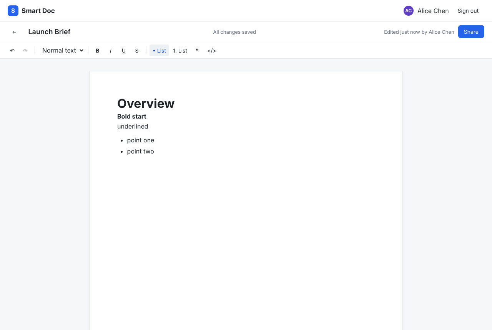

# Smart Doc

A lightweight collaborative document editor inspired by Google Docs. You can create, format, import, share and co-edit documents, with live presence and change sync.

**Live demo:** _see [`SUBMISSION.md`](SUBMISSION.md)_ · **Demo accounts:** `alice@ajaia.dev`, `bob@ajaia.dev`, `carol@ajaia.dev`, all with password **`demo1234`**. The login screen also has one-click buttons for each.



## What it does

| Area | What works |
| --- | --- |
| **Documents** | Create, rename (click the title), edit, delete (owner only). Changes autosave about 0.8 s after you stop typing. <kbd>Ctrl/⌘+S</kbd> saves immediately, and you're warned if you try to leave with unsaved changes. |
| **Rich text** | Bold, italic, underline, strikethrough, headings H1–H3, bulleted and numbered lists, quotes, code blocks, links, undo/redo. Content is stored as structured JSON (ProseMirror), so formatting round-trips exactly. |
| **File import** | Upload a **`.txt`, `.md` or `.docx`** file (max 2 MB) from the dashboard and it becomes a new editable document. Headings, lists, bold/italic and links are kept. Other file types are rejected with a clear message. |
| **Sharing** | Every document has one **owner**. The owner shares by email as **Can edit** or **Can view**, can change the role, and can revoke access. The dashboard splits **My documents** from **Shared with me** (owner avatar plus a role badge). Viewers get a read-only editor. |
| **Live collaboration** | People who have the doc open appear as avatars. When a collaborator saves, other open copies update within about a second. If two people edit the same doc at once, the second save is **detected, not silently overwritten**: they choose "load theirs" or "keep mine". Revoked users are told straight away. |
| **Persistence** | Postgres (Supabase in production, embedded PGlite locally). Documents, formatting and shares survive refreshes and redeploys. |

## Run locally

Requirements: Node 20+ (tested on 22). No database or accounts needed.

```bash
npm install
npm run dev          # http://localhost:3000
```

With no `DATABASE_URL` set, the app uses **PGlite** (Postgres compiled to WASM) and stores data in `./.data/pglite`. Tables and demo users are created on first request. Delete `.data/` to reset.

To try sharing, sign in as Alice in one browser and as Bob in another (or a private window).

Optional `.env.local` (see [`.env.example`](.env.example)):

| Variable | Purpose |
| --- | --- |
| `DATABASE_URL` | Use a real Postgres instead of PGlite. |
| `SESSION_SECRET` | Signs session cookies. **Required on Vercel**. Locally a dev default is used. |
| `NEXT_PUBLIC_SUPABASE_URL`, `NEXT_PUBLIC_SUPABASE_ANON_KEY` | Turn on Supabase Realtime for presence and instant sync. Without them, open documents poll for changes every 5 s, so live sync still works locally but presence avatars are off. |

### Tests

```bash
npm test             # unit/integration tests (Vitest + in-memory Postgres)
npm run typecheck
npm run e2e          # browser smoke test; needs a running server (see below)
```

- `tests/documents.test.ts` covers the access-control and persistence rules against a real (in-memory) Postgres: who can see, edit, share and delete; rich-text round-trips; optimistic-locking conflicts; schema validation of saved content.
- `tests/importer.test.ts` covers Markdown, text and docx import, including dropping `<script>` and rejecting bad, empty and oversized files.
- `e2e/smoke.mjs` drives three real browsers (Alice, Bob, Carol) through create → format → reload → share → live sync both ways → viewer read-only → edit conflict → import → revoke. To run it: `rm -rf .data && npm run build && npm start`, then in another terminal `npx playwright install chromium` (first time only) and `npm run e2e`.

## Deploy (Vercel + Supabase, both free tiers)

1. **Supabase**: create a project. In **Connect → Connection string → Transaction pooler**, copy the URI (port `6543`) and fill in your DB password. In **Project Settings → API**, copy the Project URL and the `anon` public key.
2. **Initialise the DB** (optional; the app also does this on first request):
   `DATABASE_URL="postgresql://…:6543/postgres" npm run db:setup`
3. **Vercel**: import the GitHub repo (framework: Next.js, defaults are fine). Add these environment variables:
   - `DATABASE_URL`: the pooler URI from step 1
   - `SESSION_SECRET`: output of `openssl rand -hex 32`
   - `NEXT_PUBLIC_SUPABASE_URL`, `NEXT_PUBLIC_SUPABASE_ANON_KEY`: from step 1
4. Deploy. Open the URL, sign in as Alice in one browser and as Bob in another, and open "Q4 Planning Notes".

Realtime uses public Broadcast and Presence channels, which new Supabase projects allow by default. Only "version N was saved" notices go over them, never document content (see the architecture note).

## Project layout

```
src/
  app/                    Next.js App Router pages + API route handlers
    api/documents/…       CRUD, sharing, import endpoints
  components/             Dashboard, DocumentEditor, Toolbar, ShareDialog
  lib/
    documents.ts          Domain logic: access control, sharing, optimistic locking
    content.ts            Schema validation + HTML → document conversion
    importer.ts           .txt/.md/.docx import
    db.ts                 Postgres (pg) or PGlite behind one tiny interface; schema
    realtime.ts           Supabase presence + change notifications
    session.ts            Signed-cookie sessions (jose)
tests/                    Vitest suites
e2e/                      Playwright smoke test
```

## Docs

- [ARCHITECTURE.md](ARCHITECTURE.md): what I prioritised and why, plus tradeoffs and next steps
- [AI_WORKFLOW.md](AI_WORKFLOW.md): how AI tools were used and checked
- [SUBMISSION.md](SUBMISSION.md): what's included and what's working or incomplete
